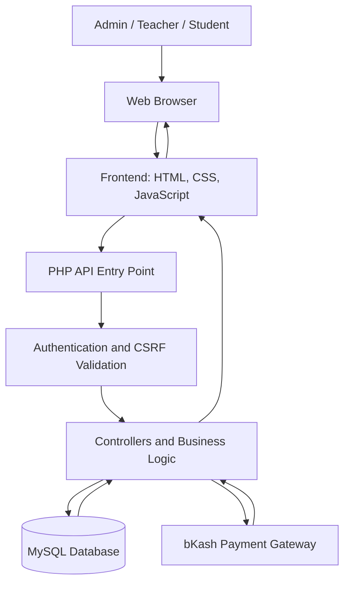
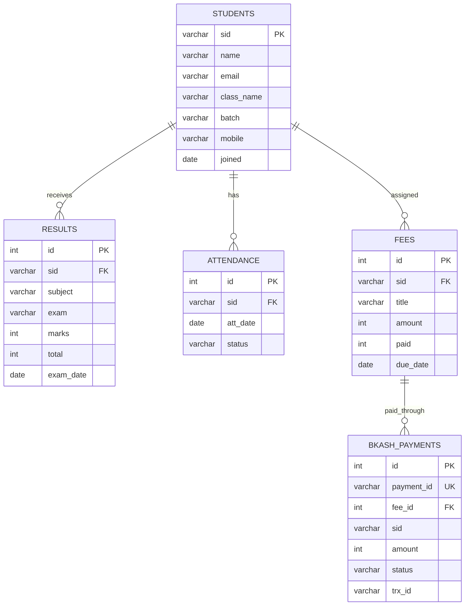
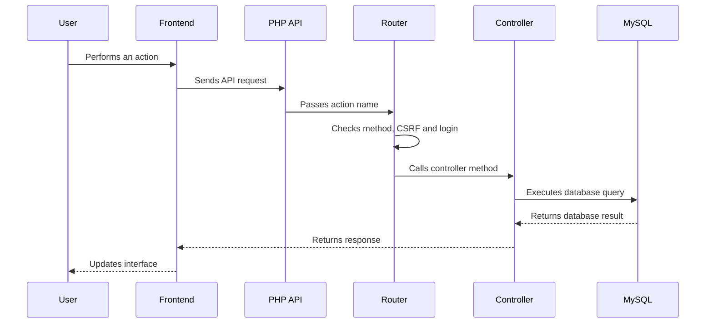
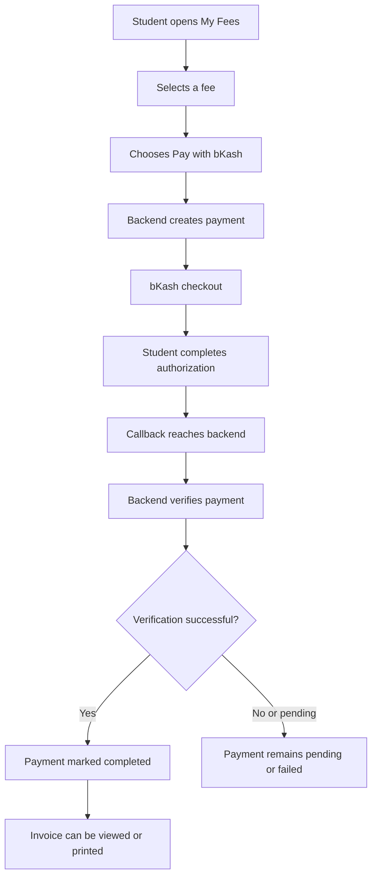

<div align="center">

<table>
<tr><td align="center" bgcolor="#102A43">

# <font color="#FFFFFF">EDUTRACK PRO</font>
## <font color="#FFFFFF">STUDENT MANAGEMENT SYSTEM</font>

<font color="#D9EAF7">PROFESSIONAL PROJECT DOCUMENTATION • DATABASE DESIGN • IMPLEMENTATION GUIDE</font>

</td></tr>
</table>

### A Web-Based Academic Administration Platform

</div>

<table>
<tr><th colspan="2" align="center">STUDENT PROFILE</th></tr>
<tr><td width="38%"><b>Student ID</b></td><td><b>251031021</b></td></tr>
<tr><td><b>Department</b></td><td>Computer Science &amp; Engineering (CSE)</td></tr>
<tr><td><b>Program</b></td><td>Undergraduate (UG)</td></tr>
<tr><td><b>Batch</b></td><td><b>34</b></td></tr>
<tr><td><b>Project Title</b></td><td>EduTrack Pro — Student Management System</td></tr>
</table>

<div align="center">


</div>

> **ACADEMIC SUBMISSION DOCUMENT**  
> This document explains the system overview, features, architecture, database tables, SQL implementation, application workflow, installation, testing and deployment considerations.

---

## 01 · PROJECT AT A GLANCE

<table>
<tr><th align="left">Project Information</th><th align="left">Description</th></tr>
<tr><td><b>System Type</b></td><td>Web-Based Student &amp; Academic Information Management System</td></tr>
<tr><td><b>User Roles</b></td><td>Administrator, Teacher and Student</td></tr>
<tr><td><b>Core Modules</b></td><td>Students, Teachers, Attendance, Results, Notices, Fees and Admissions</td></tr>
<tr><td><b>Payment Module</b></td><td>bKash Tokenized Checkout — sandbox/test configuration</td></tr>
<tr><td><b>Database</b></td><td>MySQL (InnoDB, relational constraints)</td></tr>
<tr><td><b>Runtime</b></td><td>PHP with Apache; XAMPP or compatible cPanel hosting</td></tr>
</table>

### Project Overview

EduTrack Pro is a web-based Student Management System developed to organize common academic and administrative activities in one platform. It provides role-based access for administrators, teachers and students. Authorized users can manage student and teacher information, record attendance, publish examination results, share notices and maintain fee records.

The system also includes a public admission-request form and a bKash payment workflow. The frontend uses HTML, CSS and JavaScript, the backend is developed in PHP, and MySQL is used for persistent data storage.

### Project Objectives

| No. | Objective | Expected Benefit |
|---:|---|---|
| 01 | Centralize student and teacher records | Organized academic information |
| 02 | Provide role-based access | Controlled system operations |
| 03 | Maintain attendance records | Easier attendance monitoring |
| 04 | Store examination results | Structured result management |
| 05 | Track fees and payments | Clear payment and due information |
| 06 | Publish notices and receive admission requests | Improved information flow |

### Main Modules

<table>
<tr><th>Module</th><th>Key Functions</th></tr>
<tr><td>Authentication</td><td>Login, logout and role-based access</td></tr>
<tr><td>Student Management</td><td>Add, update, delete and manage student records</td></tr>
<tr><td>Teacher Management</td><td>Manage teacher profiles and permissions</td></tr>
<tr><td>Attendance</td><td>Save and review daily attendance records</td></tr>
<tr><td>Results</td><td>Record examination marks; application calculates grade/GPA</td></tr>
<tr><td>Notices</td><td>Publish and remove announcements</td></tr>
<tr><td>Fees</td><td>Create fee records, record payments and track dues</td></tr>
<tr><td>Online Payment</td><td>bKash Tokenized Checkout workflow</td></tr>
<tr><td>Admission</td><td>Receive and process admission requests</td></tr>
<tr><td>Settings</td><td>Update system settings and account password</td></tr>
</table>

---

## 02 · TECHNOLOGY STACK

| Layer | Technology | Responsibility |
|---|---|---|
| Frontend | HTML5 | Page structure |
| Frontend | CSS3 | Layout and visual presentation |
| Frontend | JavaScript | Client-side interaction and API requests |
| Backend | PHP | Server-side logic and API handling |
| Database | MySQL | Persistent relational data storage |
| Database Access | PDO | Database connectivity and prepared queries |
| Payment | bKash Tokenized Checkout | Online fee payment workflow |
| Web Server | Apache | Application hosting and request handling |

---

## 03 · SYSTEM ARCHITECTURE

The browser-based frontend sends requests to the PHP API. The backend routes requests to the relevant controller, performs authentication and permission checks, communicates with MySQL through PDO, and returns a response to the frontend.



### Role & Permission Matrix

| Functionality | Administrator | Teacher | Student |
|---|:---:|:---:|:---:|
| Manage student records | ✓ | Permission-based | — |
| Manage teacher records | ✓ | — | — |
| Record attendance | ✓ | Permission-based | — |
| Manage examination results | ✓ | Permission-based | — |
| Publish notices | ✓ | Permission-based | — |
| View personal academic information | ✓ | ✓ | ✓ |
| View fee information | ✓ | — | ✓ |
| Use student payment workflow | — | — | ✓ |

*Teacher permissions for results, attendance and notices can be controlled by the administrator. The matrix is a high-level summary; actual access is enforced by backend controller permissions.*

---

## 04 · PROJECT DIRECTORY STRUCTURE

```text
student-management/
└── project/
    ├── index.html
    ├── README.md
    ├── frontend/
    │   ├── index.html
    │   ├── login.html
    │   ├── register.html
    │   ├── app.html
    │   ├── pay.html
    │   ├── invoice.html
    │   ├── css/style.css
    │   ├── js/
    │   │   ├── script.js
    │   │   ├── app.js
    │   │   ├── common.js
    │   │   ├── pay.js
    │   │   └── invoice.js
    │   └── images/
    ├── backend/
    │   ├── index.php
    │   ├── bkash_callback.php
    │   ├── bkash_test.php
    │   ├── server/
    │   ├── routes/api.php
    │   └── controllers/
    └── database/database.sql
```

> **DIRECTORY NOTE**  
> Keep `frontend/`, `backend/` and `database/` in their existing relative positions. The frontend communicates with `../backend/index.php`.

---

## 05 · DATABASE DESIGN

The supplied SQL file is `database/database.sql`. It defines **9 relational tables** using InnoDB and `utf8mb4` character encoding.

### Entity Relationship Diagram (ERD)



### Database Table Dictionary

| No. | Table Name | Purpose | Primary / Key Fields |
|---:|---|---|---|
| 01 | `users` | User login accounts and roles | `uid` (PK), `role`, `name`, `email` |
| 02 | `students` | Student profile information | `sid` (PK), `name`, `class_name`, `batch` |
| 03 | `results` | Examination records | `id` (PK), `sid` (FK), `subject`, `marks`, `total` |
| 04 | `attendance` | Daily attendance records | `id` (PK), `sid` (FK), `att_date`, `status` |
| 05 | `notices` | System announcements | `id` (PK), `title`, `body`, `priority` |
| 06 | `settings` | Application key-value settings | `k` (PK), `v` |
| 07 | `registrations` | Public admission requests | `id` (PK), `name`, `email`, `pw_hash` |
| 08 | `fees` | Fee and payment summary records | `id` (PK), `sid` (FK), `amount`, `paid` |
| 09 | `bkash_payments` | bKash transaction records | `id` (PK), `payment_id` (Unique), `fee_id` (FK) |

### Important Keys & Relationships

| Relationship / Constraint | Description |
|---|---|
| `students.sid` | Primary key of the student table |
| `results.sid` → `students.sid` | Result belongs to a student; cascade on delete/update |
| `attendance.sid` → `students.sid` | Attendance belongs to a student; cascade on delete/update |
| `fees.sid` → `students.sid` | Fee belongs to a student; cascade on delete/update |
| `bkash_payments.fee_id` → `fees.id` | Payment is associated with a fee; cascade on delete |
| `attendance (sid, att_date)` | Unique pair prevents duplicate attendance for one student/date |
| `bkash_payments.payment_id` | Unique payment identifier |

---

## 06 · SQL IMPLEMENTATION — STEP BY STEP

> **HOW TO USE THIS SECTION**  
> Open phpMyAdmin, select the project database, and run the sample queries below. The complete original schema is available in `database/database.sql` and should be imported to create all nine tables.

### Step 01 — Create the Database

**Purpose:** Create a database for the application.

```sql
CREATE DATABASE edutrack_db
CHARACTER SET utf8mb4
COLLATE utf8mb4_unicode_ci;

USE edutrack_db;
```

### Step 02 — Create All Required Tables

**Purpose:** Build the database structure using the supplied project schema.

1. Open **phpMyAdmin**.
2. Create or select the database (for example, `edutrack_db`).
3. Open the **Import** tab.
4. Choose `database/database.sql` from the project folder.
5. Click **Import / Go** and wait for completion.
6. Confirm that all nine tables appear in the database.

```sql
-- The full CREATE TABLE statements are maintained in:
-- project/database/database.sql
-- Import that file instead of recreating a partial schema here.
```

### Step 03 — Display All Student Records

**Purpose:** Retrieve student details in alphabetical order.

```sql
SELECT sid, name, email, class_name, batch, mobile, joined
FROM students
ORDER BY name ASC;
```

### Step 04 — Search a Student by ID

**Purpose:** Find a particular student using the unique student ID.

```sql
SELECT *
FROM students
WHERE sid = 'STUDENT_ID';
```

Replace `STUDENT_ID` with an actual student ID.

### Step 05 — Display Examination Results

**Purpose:** Show the selected student's examination records, newest first.

```sql
SELECT subject, exam, marks, total, exam_date
FROM results
WHERE sid = 'STUDENT_ID'
ORDER BY exam_date DESC;
```

### Step 06 — Display Attendance History

**Purpose:** Review attendance records for a selected student.

```sql
SELECT sid, att_date, status, marked_by
FROM attendance
WHERE sid = 'STUDENT_ID'
ORDER BY att_date DESC;
```

### Step 07 — Calculate Outstanding Fees

**Purpose:** Calculate due amount by subtracting the paid amount from the total amount.

```sql
SELECT sid, title, amount, paid,
       (amount - paid) AS due_amount,
       due_date
FROM fees
WHERE sid = 'STUDENT_ID';
```

### Step 08 — Display bKash Payment History

**Purpose:** Review recorded payment transactions for a student.

```sql
SELECT payment_id, fee_id, sid, amount,
       status, trx_id, created_at
FROM bkash_payments
WHERE sid = 'STUDENT_ID'
ORDER BY created_at DESC;
```

### Step 09 — Generate an Attendance Summary

**Purpose:** Count attendance records grouped by student and status.

```sql
SELECT sid, status, COUNT(*) AS total_days
FROM attendance
GROUP BY sid, status
ORDER BY sid, status;
```

> **SQL SAFETY NOTE**  
> These are sample read/report queries. Use the authenticated application interface for normal data entry and updates. Back up the database before performing maintenance operations.

---

## 07 · BACKEND API WORKFLOW

The API entry point is `backend/index.php?api=ACTION`. The route map in `backend/routes/api.php` connects each action to its controller method.



### Selected API Actions

| API Action | Purpose | Access Type |
|---|---|---|
| `init` | Initialize public application data | Public |
| `login` | Authenticate a user | Public |
| `logout` | End the current session | Public |
| `register_submit` | Submit an admission request | Public |
| `bootstrap` | Load dashboard data | Authenticated |
| `student_add` / `student_update` | Add or update a student | Authenticated / permission checked |
| `teacher_add` | Add a teacher | Authenticated / permission checked |
| `att_save` | Save attendance | Authenticated / permission checked |
| `result_add` | Add an examination result | Authenticated / permission checked |
| `notice_add` | Publish a notice | Authenticated / permission checked |
| `fee_add` / `fee_pay` | Manage fee records and payments | Authenticated |
| `bkash_create` | Start a bKash payment | Authenticated |
| `invoice_get` | Retrieve invoice information | Authenticated |

The router requires POST requests and a valid CSRF token for actions other than `init`. Controller-level role and permission checks apply to protected operations.

---

## 08 · INSTALLATION & EXECUTION

### System Requirements

| Requirement | Recommended / Required |
|---|---|
| Web Server | Apache |
| Backend Runtime | PHP 7.4 or newer |
| Database | MySQL or MariaDB |
| PHP Extensions | `pdo_mysql`, `mbstring` |
| Payment Connectivity | PHP cURL and HTTPS for bKash integration |
| Local Environment | XAMPP / WAMP |
| Hosting | Compatible cPanel hosting |

### Option A — Run with XAMPP

| Step | Action | Details |
|---:|---|---|
| 01 | Start services | Open XAMPP and start Apache and MySQL |
| 02 | Copy project | Extract to `C:\xampp\htdocs\student-management\` |
| 03 | Create database | Open `http://localhost/phpmyadmin` and create `edutrack_db` |
| 04 | Import schema | Import `project/database/database.sql` |
| 05 | Configure connection | Edit `project/backend/server/config.php` |
| 06 | Open application | Visit the frontend login page |

**Example local database configuration** (adjust to your own environment):

```php
define('DB_HOST', 'localhost');
define('DB_NAME', 'edutrack_db');
define('DB_USER', 'root');
define('DB_PASS', '');
```

**Application URL:**

```text
http://localhost/student-management/project/frontend/login.html
```

### Option B — Deploy on cPanel

1. Create a MySQL database in **cPanel → MySQL Databases**.
2. Create a database user and grant the required privileges.
3. Upload the project files to `public_html` or a selected subfolder.
4. Keep `frontend/`, `backend/` and `database/` in their relative positions.
5. Update database credentials in `backend/server/config.php`.
6. Select PHP 7.4 or newer and enable `pdo_mysql` and `mbstring`.
7. Enable HTTPS using the hosting provider's SSL facility.
8. Import `database/database.sql` through phpMyAdmin if required.
9. Open the frontend login page in a browser.

---

## 09 · DEFAULT ADMINISTRATOR ACCOUNT

<table>
<tr><th align="left">Login Field</th><th align="left">Default Value</th></tr>
<tr><td>User ID</td><td><code>admin</code></td></tr>
<tr><td>Password</td><td><code>admin123</code></td></tr>
<tr><td>Role</td><td><code>admin</code></td></tr>
</table>

> **IMPORTANT SECURITY WARNING**  
> Change the default password immediately after the first successful login. Never keep default credentials on a public production website.

---

## 10 · BKASH PAYMENT WORKFLOW

The project includes a bKash Tokenized Checkout integration configured for **sandbox / test mode**.



| Stage | Process |
|---:|---|
| 01 | Student opens the fee section and selects a fee |
| 02 | Student chooses the bKash payment option |
| 03 | Backend creates a payment request |
| 04 | Student completes authorization at bKash checkout |
| 05 | Backend receives the callback and verifies the transaction |
| 06 | Payment status is updated after successful verification |
| 07 | Invoice information can be viewed or printed |

> **PAYMENT NOTE**  
> A payment must be treated as completed only after server-side verification. Live transactions require valid merchant credentials, the production gateway URL, a public HTTPS callback URL and production hosting. Do not use sandbox credentials for live payments.

---

## 11 · SECURITY & MAINTENANCE

| Security Area | Recommended Practice |
|---|---|
| Passwords | Store secure password hashes; never store plain-text passwords |
| Admin Account | Change the default password immediately |
| Database Credentials | Keep credentials private and outside public documentation |
| Transport | Use HTTPS for public deployment |
| SQL Queries | Use PDO prepared statements |
| API Protection | Require authentication and CSRF validation for protected actions |
| Permissions | Enforce role and permission checks on the backend |
| Diagnostics | Remove or restrict diagnostic scripts such as `backend/bkash_test.php` after troubleshooting |
| Backups | Maintain regular database backups |
| Shared Archives | Never distribute real database passwords or private merchant credentials; rotate exposed secrets |

---

## 12 · SYSTEM TESTING CHECKLIST

| No. | Test Scenario | Expected Result |
|---:|---|---|
| 01 | Open login page | Login interface loads correctly |
| 02 | Submit valid credentials | Appropriate dashboard opens |
| 03 | Submit invalid credentials | Access is denied |
| 04 | Add a student as an authorized admin | Student record is saved |
| 05 | Record attendance | Attendance is stored for the selected date |
| 06 | Add examination marks | Result record is saved |
| 07 | Publish a notice | Notice appears in the application |
| 08 | Create a fee record | Fee is associated with a student |
| 09 | Check fee due | Due is calculated as amount minus paid |
| 10 | Complete a sandbox bKash payment | Backend verifies and updates payment status |
| 11 | Open an invoice | Invoice information is displayed |

---

## 13 · LIMITATIONS & DEPLOYMENT NOTES

- The supplied bKash configuration is intended for sandbox testing; live payment processing requires production credentials and configuration.
- The application requires a functioning PHP and MySQL hosting environment.
- Database schema and API descriptions in this document are based on the supplied project files.
- Hosting-specific credentials and settings must be configured before deployment.
- Back up the database before maintenance, migration or reset operations.

---

## 14 · CONCLUSION

EduTrack Pro brings several student administration activities into one web-based platform. Role-based access, a centralized MySQL database, attendance and result management, fee tracking, admission requests and bKash sandbox integration provide a foundation for digital academic administration.

The project demonstrates the integration of a JavaScript-based frontend, PHP backend and MySQL relational database to support a practical Student Management System.

---

<div align="center">

<table>
<tr><td align="center" bgcolor="#102A43">

## <font color="#FFFFFF">END OF PROJECT DOCUMENTATION</font>

<font color="#D9EAF7">EDUTRACK PRO — STUDENT MANAGEMENT SYSTEM</font>

<font color="#FFFFFF">STUDENT ID: 251031021&nbsp; | &nbsp;CSE&nbsp; | &nbsp;UG BATCH: 34</font>

</td></tr>
</table>

</div>
